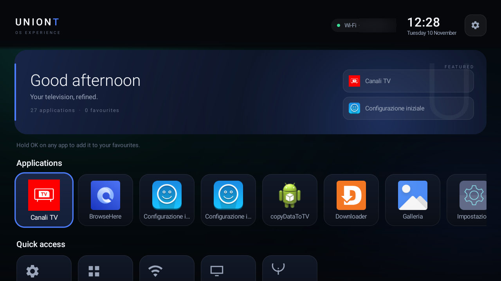
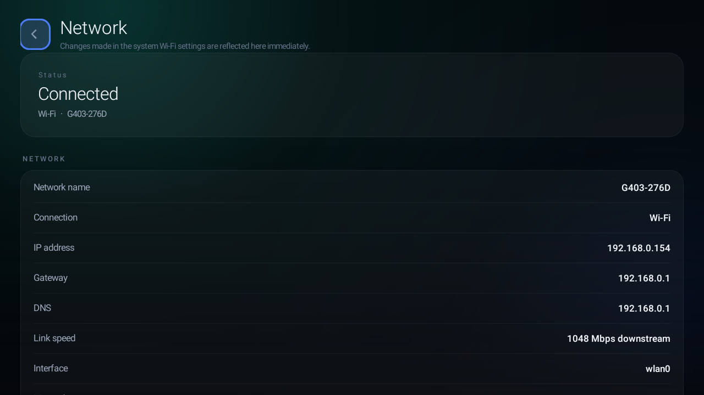
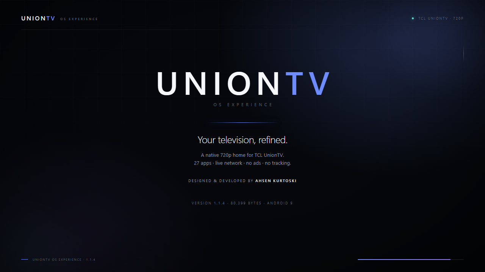

# UNIONTV OS EXPERIENCE

A lightweight, premium home experience for Android TV, built natively for the
TCL UnionTV (Android 9, ARMv7, 720p, 1.4 GB RAM).

**Designed & Developed by Ahsen Kurtoski.**

[](https://github.com/AhsenKurtoski/UnionTV-OS-Experience/actions/workflows/release-check.yml)





*Full 1.1.4 gallery: [docs/SCREENSHOTS.md](docs/SCREENSHOTS.md). Published screenshots redact the Wi-Fi network name and local IP addresses.*

The launcher is a single native Android app with **zero third-party
dependencies**: no Compose, no Leanback, no RecyclerView, no analytics, no
background services and no network access. The whole release APK is **78.5 KB**.

### Launch film

[](docs/launch/uniontv-launch-15s.mp4)

**[Watch the 15-second launch film](docs/launch/uniontv-launch-15s.mp4)** —
1280×720, 30 fps, H.264/AAC, original score. Production notes, timeline and
regeneration steps: [docs/launch/README.md](docs/launch/README.md).

### Release v1.1.4

The signed APK and the redacted launch assets are attached to
**[GitHub release v1.1.4](https://github.com/AhsenKurtoski/UnionTV-OS-Experience/releases/tag/v1.1.4)**:
[APK](https://github.com/AhsenKurtoski/UnionTV-OS-Experience/releases/download/v1.1.4/UnionTV-1.1.4.apk) ·
[launch film](https://github.com/AhsenKurtoski/UnionTV-OS-Experience/releases/download/v1.1.4/uniontv-launch-15s.mp4) ·
[poster](https://github.com/AhsenKurtoski/UnionTV-OS-Experience/releases/download/v1.1.4/uniontv-launch-poster.png).
Release notes, checksums and the tested matrix are on the release page.

### Documentation

| Guide | Contents |
| --- | --- |
| [Features](docs/FEATURES.md) | Every screen, control, setting, privacy boundary and limit |
| [Architecture](docs/ARCHITECTURE.md) | Activity/screen stack, repository, icon pool, persistence, build |
| [QA](docs/QA.md) | Tested device, matrix, measured results and untested paths |
| [Screenshots](docs/SCREENSHOTS.md) | Real 1.1.4 TV captures and startup states |
| [Launch film](docs/launch/README.md) | 15 s video, poster, scene timeline and render pipeline |
| [Performance](docs/PERFORMANCE.md) | Startup, memory, rendering and storage measurements |
| [Compatibility](docs/COMPATIBILITY.md) | Supported versions and device checklist |
| [Recovery](docs/RECOVERY.md) | Restore Google TV, post-OTA checks, uninstall |
| [Changelog](CHANGELOG.md) | 1.1.4 release facts and project history |

### What's new in 1.1.4

- The application rail is published only after its real icons are resolved in
  memory or from the on-disk cache; there are no letter placeholders.
- The first cold start shows a clean **Loading applications…** state; warm
  starts reuse the icon cache in `filesDir`. Icon decoding uses a small
  background pool.
- `tools/home.sh` provides `status`, `check`, `uniontv` and `googletv`; `check`
  is the read-only post-firmware-update check.
- Reference-TV cleanup remains: Netflix, Kodi, Pluto TV and AirScreen removed;
  **27 launchable apps** and about **1.8 GB free** on `/data`.
- UnionTV remains the only Home candidate for user 0; the Google TV system APK
  is retained and can be restored.

---

## What it is

A complete replacement home screen that discovers and launches the applications
actually installed on the television, with real labels and real icons.

| Screen | What it does |
| --- | --- |
| **Home** | Pinned brand/clock/status bar with live SSID, greeting hero, favourites rail, full application rail, quick-access rail, footer credit. |
| **Applications** | Full grid of every launchable app, sortable A–Z / Recent / Favourites, long-press actions. |
| **Settings** | Accent colour, background style, reduced motion, 24-hour clock, favourites rail visibility, restore defaults. |
| **Network** | Live Wi-Fi/Ethernet status, network name (SSID), IP address, signal and link details. |
| **System** | Device model, Android version, ABI, display, memory and storage figures. |
| **About** | Project identity, version, compatibility, package name and disclaimer. |

### Features

- Real app discovery through `CATEGORY_LEANBACK_LAUNCHER` and
  `CATEGORY_LAUNCHER`, with no hardcoded package list.
- Live Wi-Fi SSID and connected dot, read locally with `ACCESS_WIFI_STATE` and
  the Android location permission; there is no Internet permission.
- **Canali TV** (`com.tcl.tv`) pinned first as the television input on the TCL
  UnionTV.
- Favourites: hold **OK** on any app, choose *Add to favourites*; the Home rail
  and the Applications sort update immediately.
- Long-press menu for every app: Open, Add/Remove favourite, App info, Close.
- Fast, predictable D-pad navigation with a visible focus ring at all times.
- Accent themes, four procedural backgrounds and reduced-motion mode.
- English interface with a consistent English date and time format.
- No ads, no trackers, no telemetry, no Internet permission.

---

## Requirements

- Android 5.0 (API 21) or newer; tested on Android 9 (API 28).
- Any ABI: the APK contains no native libraries.
- A D-pad remote; touch also works.
- 1280×720 or larger display (the layout is density-independent).

---

## Install

### From a computer with ADB

```bash
adb connect <tv-ip>:5555        # only if ADB is already enabled on the TV
adb install -r dist/UnionTV-1.1.4.apk
```

Current release: [UnionTV-1.1.4.apk](https://github.com/AhsenKurtoski/UnionTV-OS-Experience/releases/download/v1.1.4/UnionTV-1.1.4.apk) — **80,399 bytes** — SHA-256
`3008043f871dac8b9648b60b4ff3084632a39c5888a7348edc46131e19475e5b`.

### On the television

Copy the APK to the TV (USB drive, Downloader app, file manager) and open it.
Android will ask to allow installation from that source.

After installation the app appears in the normal application list. **It does not
replace the current home screen by itself.** On the reference TV the default
Home was set explicitly after installation; the app itself never changes it.

---

## Using it as the home screen (optional)

The launcher is registered for `ACTION_MAIN` + `CATEGORY_HOME` and
`CATEGORY_LEANBACK_LAUNCHER`, so Android offers it as a Home app.

1. Open **Settings → Apps → Default apps → Home** on the TV and choose
   **UnionTV OS Experience**.
2. Or, from ADB:

   ```bash
   adb shell cmd package set-home-activity \
     com.ahsenkurtoski.uniontvos/com.ahsenkurtoski.uniontvos.MainActivity
   ```

On the reference TV UnionTV is now the only Home candidate for user 0; the
Google TV launcher was removed for that user (the system APK is retained and
can be restored, see below). The app itself never changes the default home on
its own.

### Persistence

Settings and favourites live in `SharedPreferences`; there is no scheduled
reset, no Internet permission and no background update job. The default Home
survived a full reboot in the reference test. A firmware/OTA update may restore
Google TV; the system APK is retained and the recovery steps are in
[docs/RECOVERY.md](docs/RECOVERY.md).

### Home switch and post-OTA check

`tools/home.sh` wraps the ADB commands:

```bash
bash tools/home.sh status
bash tools/home.sh check
bash tools/home.sh uniontv
bash tools/home.sh googletv
```

`check` is read-only and exits 0 only when UnionTV is the resolved HOME
activity; run it after a firmware update. `uniontv` can be given
`--remove-google-tv` if a firmware restores Google TV as the default; the
Google TV system APK is retained. `googletv` restores it.

---

## Restore the original launcher

The Google TV system APK is never modified. On the reference TV its launcher
was removed for user 0 to make UnionTV the only Home; restore it with:

```bash
adb shell cmd package install-existing com.google.android.tvlauncher
adb shell cmd package set-home-activity \
  com.google.android.tvlauncher/com.google.android.tvlauncher.MainActivity
```

If the command is not available, use **Settings → Apps → Default apps → Home**
after restoring the package.

To open the original launcher immediately without changing the default:

```bash
adb shell am start -n com.google.android.tvlauncher/.MainActivity
```

### Uninstall

```bash
adb uninstall com.ahsenkurtoski.uniontvos
```

Uninstalling removes the app and its preferences. If the Google TV launcher is
still removed for user 0, restore it first (docs/RECOVERY.md) or the TV will
fall back to the TCL fallback home.

More detail: [docs/RECOVERY.md](docs/RECOVERY.md).

---

## Controls

| Key | Action |
| --- | --- |
| D-pad | Move focus; lists scroll automatically to keep focus visible. |
| OK / Centre | Open the focused app or activate the focused control. |
| Hold OK | Open the app actions menu (Open, favourite, info, close). |
| Back | Close the menu, then return to the previous screen; on Home it stays put. |
| Menu | Open Settings from anywhere. |
| Home | Return to UnionTV Home (the default on this TV). |

---

## Build from source

Requirements: JDK 17, Android SDK with platform 33 and build-tools 33.

```bash
export JAVA_HOME=/path/to/jdk-17
./gradlew :app:assembleRelease
```

On Windows use `gradlew.bat`.

Release signing reads `keystore.properties` in the project root:

```properties
storeFile=uniontv-release.jks
storePassword=********
keyAlias=uniontv
keyPassword=********
```

Both `keystore.properties` and `*.jks` are git-ignored. To create a new key:

```bash
keytool -genkeypair -v -keystore uniontv-release.jks -alias uniontv \
  -keyalg RSA -keysize 2048 -validity 10000
```

Without a keystore file the release variant still builds, but unsigned.

Output: `app/build/outputs/apk/release/app-release.apk`.

---

## Release checks

[`.github/workflows/release-check.yml`](.github/workflows/release-check.yml)
runs on every push to `main`, on pull requests and manually. It builds the
unsigned release APK with JDK 17, verifies the 10 documented screenshots are
1280×720, checks the launch film is H.264/AAC, 1280×720, 30 fps and 15.000 s,
and uploads the APK as a workflow artifact. Signing keys are never stored in the
repository.

---

## Project structure

```
app/src/main/java/com/ahsenkurtoski/uniontvos/
  MainActivity.java          single activity, screen stack, key handling
  core/AppEntry.java         one launchable application
  core/AppRepository.java    package discovery, icon cache, favourites, launch
  core/Prefs.java            SharedPreferences-backed settings
  core/DeviceInfo.java       system and display facts
  core/NetworkMonitor.java   connectivity snapshot
  ui/                        screens, cards, rails, focus ring, theme
app/src/main/res/            strings, styles, vector icons, launcher assets
docs/                        features, architecture, QA, screenshots, recovery
  performance, compatibility, audit captures
docs/launch/                 15 s film, poster, HTML stage, frames, original score
tools/home.sh                ADB Home switch and post-OTA check
```

Architecture in one sentence: one activity, a stack of plain `FrameLayout`
screens, one repository that discovers apps on one background thread and
decodes icons on a small pool (memory + disk cache), and a small set of
custom-drawn views.

---

## Performance

Measured on the actual TCL UnionTV (Android 9, ARMv7, 720p):

| Metric | Result |
| --- | --- |
| Release APK | 80,399 bytes (78.5 KB) |
| Launchable apps | 27 |
| Cold start, loading frame (`ThisTime`, 1.1.4) | 1,195 ms |
| Warm start (`ThisTime`, 1.1.4) | 543 ms |
| Rendering baseline (1.1.2 drawing path) | 0 / 88 horizontal; 5 / 17 full-page jump |
| Frame time p50 / p90 / p99 (1.1.2 baseline) | 12 / 16 / 22 ms |

1.1.4 changes icon loading only; the rendering figures above are the unchanged
1.1.2 drawing baseline. Full method and raw figures: [docs/PERFORMANCE.md](docs/PERFORMANCE.md).
The device-level test matrix and its limits are in [docs/QA.md](docs/QA.md).

---

## Compatibility

Tested checklist, supported versions and known limitations:
[docs/COMPATIBILITY.md](docs/COMPATIBILITY.md).

---

## Permissions and privacy

- `ACCESS_NETWORK_STATE` — read-only, to show Wi-Fi/Ethernet status.
- `ACCESS_WIFI_STATE` — read the current Wi-Fi SSID.
- `ACCESS_COARSE_LOCATION` / `ACCESS_FINE_LOCATION` — required by Android to
  expose the SSID; used only for the network name, never to read or store GPS
  location. The TV's location toggle must be on.
- `QUERY_ALL_PACKAGES` — required on API 30+ to enumerate launchable apps;
  ignored on Android 9.

There is **no Internet permission**, no advertising ID, no analytics, no crash
reporting and no background service.

---

## Limitations

- Interface copy is English only. Application names keep the language chosen by
  each app (Italian system apps show Italian names).
- No search, voice input, widgets, drag-and-drop reordering or per-app folders.
- Four procedural background styles; no custom image import.
- "Featured" shows favourites first, then recently used apps; it disappears when
  neither exists.
- The SSID is shown only when Location is enabled on the TV (Android
  requirement); otherwise the top bar shows `Wi-Fi`.
- The pinned **Canali TV** entry is specific to the TCL `com.tcl.tv` input; on
  other devices the launcher lists the available apps without that pin.
- On the reference TV the Google TV launcher is removed for user 0; a firmware
  update may restore it. Reapply the setup in `docs/RECOVERY.md` if that happens.
- The app is a normal user application, not a privileged system app.

---

## Disclaimer

Independent customisation project. **Not affiliated with, endorsed by or
connected to TCL, Google or any application vendor.** All application names,
icons and trademarks belong to their respective owners.

Designed & Developed by **Ahsen Kurtoski**.
