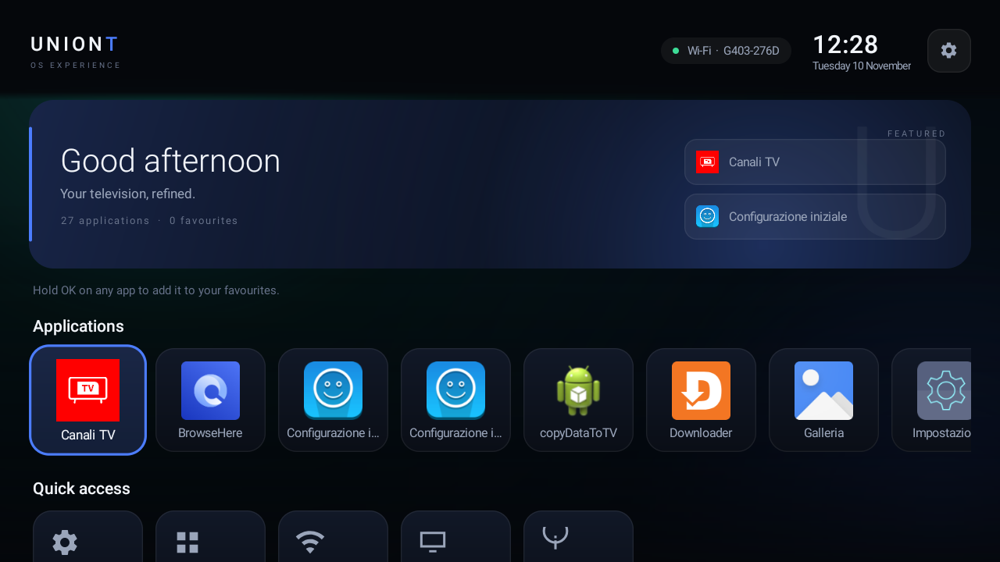
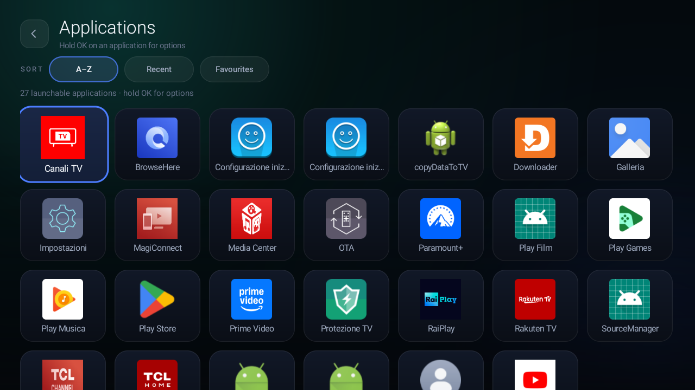
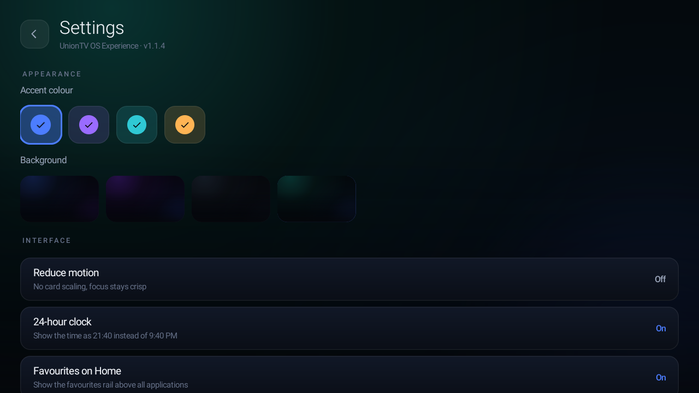
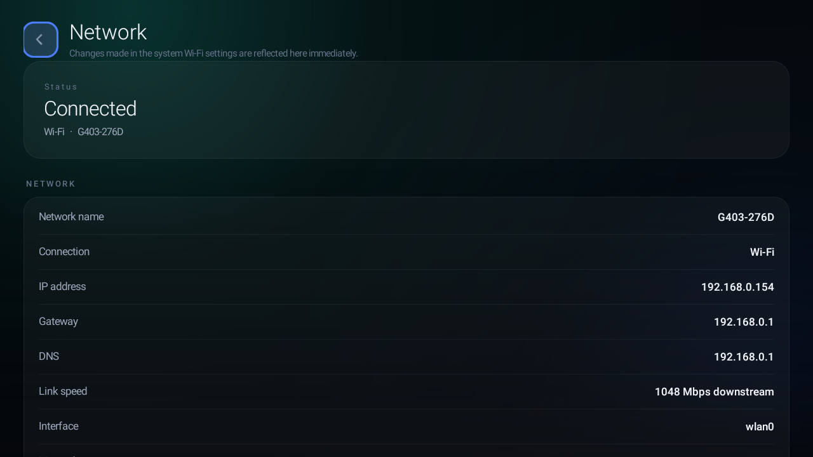

# UnionTV OS Experience — Feature guide

**Version:** 1.1.4 (versionCode 6)  
**Platform:** Android TV, tested on TCL UnionTV (Android 9 / API 28, ARMv7, 1280×720)  
**Designed & Developed by:** Ahsen Kurtoski

UnionTV OS Experience is a native replacement home screen for Android TV. It
discovers the applications actually installed on the television, resolves their
real icons and presents them in a calm, focus-first interface. There are no
third-party UI libraries, no ads, no analytics, no background services and no
Internet permission.



## What is in the box

| Area | Included |
| --- | --- |
| Home | Brand/status bar, greeting, favourites, application rail, quick access, footer credit |
| Applications | Full grid, A–Z / Recent / Favourites sorting, app actions on long-press |
| Settings | Accent colour, procedural background, reduced motion, 24-hour clock, favourites rail, restore defaults |
| Network | Live connection type, SSID, IP address, gateway, DNS, link speed and interface |
| System | Device, Android, ABI, display, memory, storage and uptime facts |
| About | Project identity, version, compatibility, package and disclaimer |
| Integration | `ACTION_MAIN` + `CATEGORY_HOME` and `CATEGORY_LEANBACK_LAUNCHER` |
| Tooling | `tools/home.sh` for Home verification, switching and post-OTA checks |

## Home

The Home screen is the default landing experience when UnionTV is the selected
Home app.

- The top bar shows the UnionTV wordmark, the live Wi-Fi/Ethernet state, the
  current SSID when available, the local time and date, and the Settings button.
- The greeting card identifies the current hour of the day and shows how many
  applications and favourites are available.
- **Favourites** shows apps marked by the user, newest first. The rail appears
  when at least one favourite exists.
- **Applications** is the main horizontal rail. **Canali TV**
  (`com.tcl.tv`) is pinned first on the reference TCL television so the TV
  input is always one press away.
- **Quick access** exposes Settings, the full application grid, Network, System
  and About.
- The footer carries the project credit and version.
- Focus is always visible with a high-contrast ring; rails scroll to keep the
  focused card on screen.

The app list is discovered at runtime. A package is shown only if it exposes a
launchable leanback or ordinary launcher activity; there is no hardcoded
package list. On the reference TV the result is **27 launchable apps**.

## Applications



The Applications screen is the complete inventory of launchable apps.

- Grid layout with real labels and real icons.
- Sort modes: **A–Z**, **Recent** and **Favourites**.
- The current sort is visible and can be changed without leaving the screen.
- **OK** opens the focused application.
- **Hold OK** opens the app action menu:
  - Open
  - Add to favourites / Remove from favourites
  - App info
  - Close
- The favourite state is shared immediately with the Home favourite rail.
- Recently-used bookkeeping is local and based on app launches through
  UnionTV.
- The grid is rebuilt from the same repository as Home; there is no second
  source of truth.

## Settings



Settings are stored locally in `SharedPreferences` and survive normal reboots.

| Setting | Behaviour |
| --- | --- |
| Accent colour | Four accent choices update focus rings, selection and highlights |
| Background | Four generated background styles; no downloaded images |
| Reduce motion | Removes card scaling and reduces movement while keeping focus crisp |
| 24-hour clock | Switches the Home clock between 24-hour and 12-hour presentation |
| Favourites on Home | Shows or hides the favourite rail independently of the saved favourites |
| Restore defaults | Returns appearance and interface settings to their defaults |

The application never changes the television's default Home on its own. Setting
UnionTV as Home is a separate, explicit action on the TV or through
`tools/home.sh`.

## Network



The Network screen is read-only and local.

- Connection status and type (Wi-Fi or Ethernet).
- Current network name (SSID), when Android exposes it.
- IPv4 address and gateway.
- DNS information when available.
- Link speed and network interface.
- The data refreshes while the activity is resumed; no polling service is
  started.
- The app declares **no Internet permission** and makes no network requests.

On Android 9 the SSID is only exposed when the TV's Location setting is on; this
is an Android platform requirement. If it is off, the launcher falls back to a
generic Wi-Fi label. See [Permissions and privacy](#permissions-and-privacy).

## System and About

The **System** screen reports device facts from the Android framework: model,
manufacturer, Android release and API level, ABI/GPU, default Home, launchable
app count, memory, internal storage, uptime, display resolution and density. The
values are read live and are not cached across the screen's lifetime.

The **About** screen identifies the project, the developer, the current version,
the supported Android target and the package name. It also carries the
independence disclaimer. The version shown there is read from the installed
package, not hardcoded into a screenshot.

## Controls

| Input | Action |
| --- | --- |
| D-pad | Move focus; rails and the grid scroll automatically |
| OK / Centre | Open the focused app or activate the focused control |
| Hold OK | Open the app action menu on a card |
| Back | Close an overlay; otherwise return to the previous screen |
| Menu | Open Settings from a screen |
| Home | Return to the Home candidate |

Touch also works where the Android TV build exposes touch input.

## Launch and Home behaviour

UnionTV registers for both Home and leanback launcher discovery. It can be used
as a normal app or selected as the TV's Home. On the reference TV, UnionTV is the
resolved Home for user 0 and the Google TV launcher is removed for that user;
the original system APK remains retained and restorable.

`tools/home.sh` provides four commands:

```bash
bash tools/home.sh status
bash tools/home.sh check
bash tools/home.sh uniontv --remove-google-tv
bash tools/home.sh googletv
```

`status` and `check` are read-only. `check` exits with status 0 only when
UnionTV is the resolved HOME activity, which makes it suitable for a
post-firmware-update check. `uniontv` and `googletv` deliberately change the
resolved Home and are not part of read-only QA.

## Icon loading and startup (1.1.4)

1.1.4 keeps the application list off-screen until its icons are ready:

- `AppRepository` discovers apps, then decodes icons on a small background pool.
- Resolved PNG icons are written to `filesDir/icons`; this cache survives normal
  cache cleaning because it is not in `cacheDir`.
- The first frame is shown immediately through `deferRefresh()`; discovery starts
  after the first frame.
- The cold start displays **Loading applications…** without letter placeholders.
- Warm starts reuse the disk cache and display the real icons directly.
- The in-memory icon cache is bounded; icons are decoded once at the display size.

Measured on the reference TV: **1,195 ms** to the first frame on a cold 1.1.4
start and **543 ms** on a warm start. These are first-frame measurements; see
[docs/PERFORMANCE.md](PERFORMANCE.md).

## Privacy and permissions

Permissions declared by the app:

| Permission | Reason |
| --- | --- |
| `ACCESS_NETWORK_STATE` | Read connectivity type and link state |
| `ACCESS_WIFI_STATE` | Read the current Wi-Fi SSID |
| `ACCESS_COARSE_LOCATION` / `ACCESS_FINE_LOCATION` | Android requirement for SSID visibility; used only for the network name |
| `QUERY_ALL_PACKAGES` | Enumerate launchable apps on API 30+; ignored on Android 9 |

There is **no `INTERNET` permission**. There is no analytics SDK, advertising ID,
crash reporting endpoint, remote configuration or background service. Settings,
favourites, last-used timestamps and the icon cache stay on the television.

## Compatibility and limits

- Minimum SDK 21; compiled against SDK 33; tested on Android 9 / API 28.
- 1280×720 tested; layouts use density-independent units and should scale to
  larger panels, but only the reference TV is part of the verified matrix.
- No native libraries, so the APK is ABI-independent.
- The **Canali TV** pin is specific to the TCL `com.tcl.tv` input. Other devices
  show their own launchable apps.
- Interface copy is English. Application labels keep the language supplied by
  each app.
- No search, voice input, widgets, folders, drag-and-drop reordering or custom
  background image import.
- The SSID label depends on the TV's Location setting.
- The app is a normal user application, not a privileged system app. A firmware
  update can restore another Home; use `tools/home.sh check` afterward.

## Documentation map

- [Screenshot gallery](SCREENSHOTS.md)
- [Architecture](ARCHITECTURE.md)
- [QA and tested limits](QA.md)
- [Performance report](PERFORMANCE.md)
- [Compatibility](COMPATIBILITY.md)
- [Recovery after an OTA](RECOVERY.md)
- [Launch video](launch/README.md)
- [Changelog](../CHANGELOG.md)
