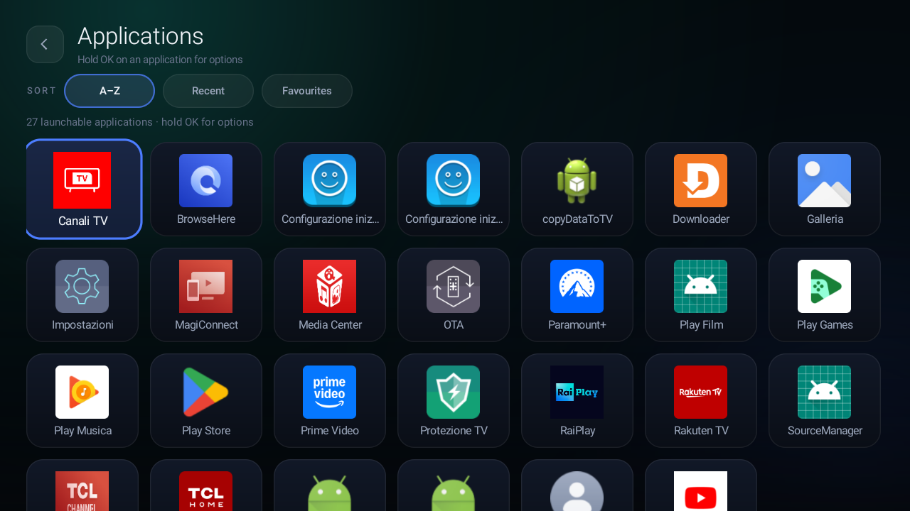
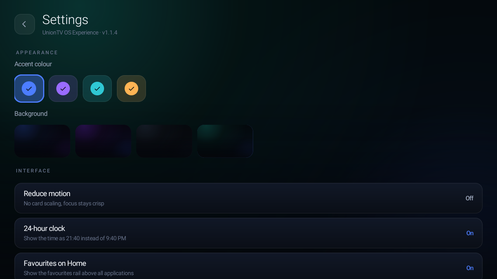
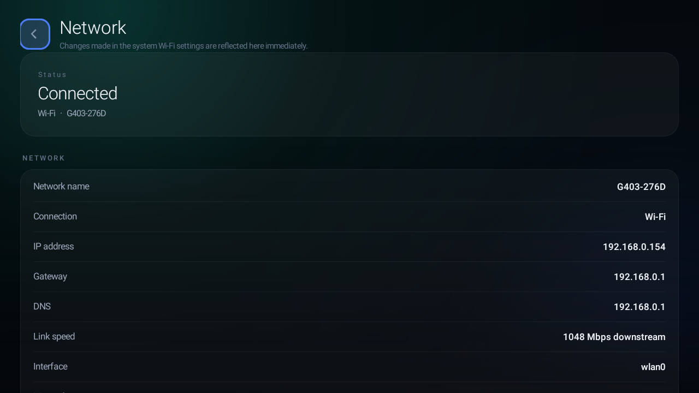
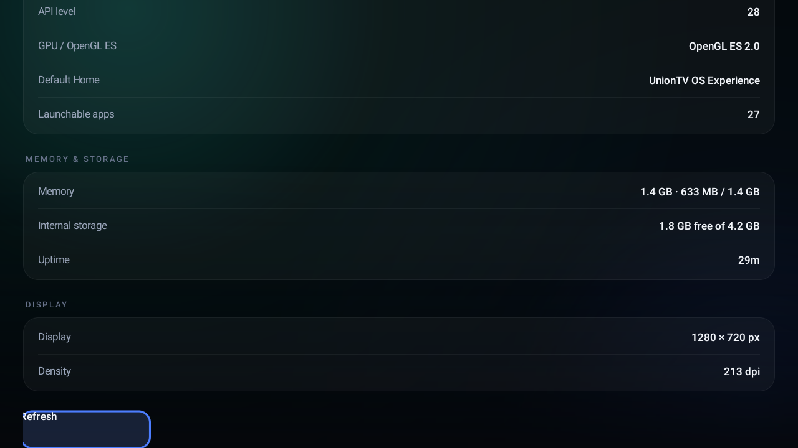
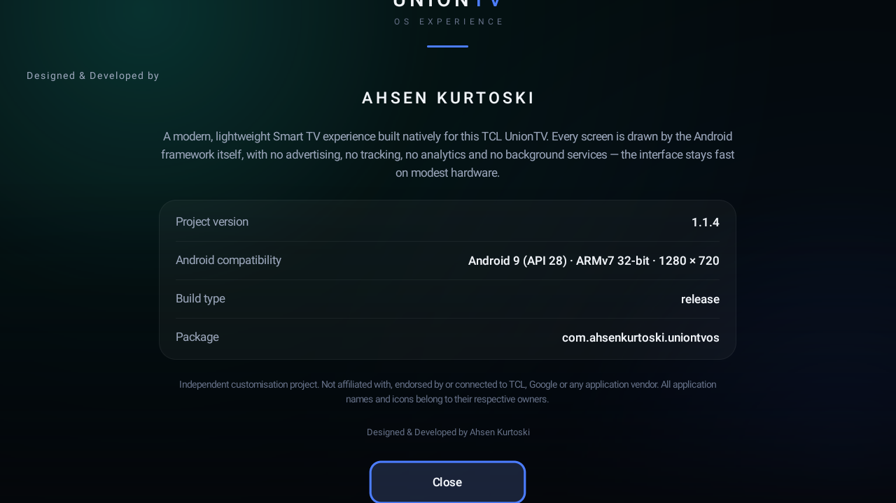
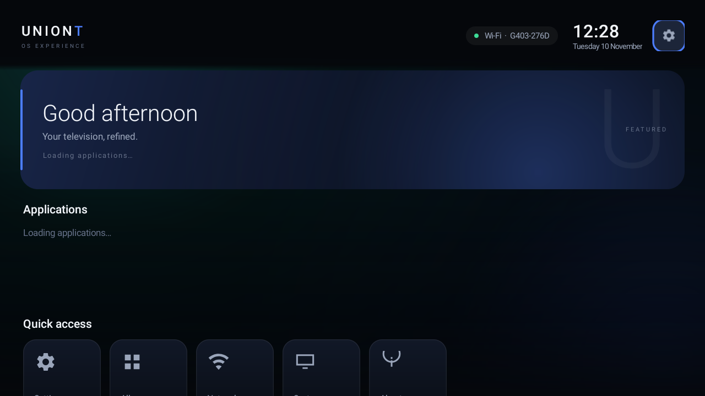
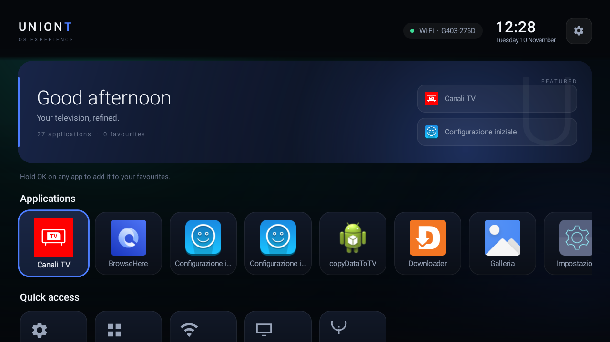

# Screenshot gallery

All images below are **real 1280×720 captures from the TCL UnionTV** running
UnionTV OS Experience 1.1.4, taken with ADB `screencap`. They are not mockups.
Network names and local IP addresses are blurred in the published captures. The
Home, Apps, Settings and Network shots are referenced by the README and the
launch video; the loading/first-frame shots document the 1.1.4 startup work.

**Release:** [v1.1.4](https://github.com/AhsenKurtoski/UnionTV-OS-Experience/releases/tag/v1.1.4) — signed APK, launch film and poster.

## Home

The final Home screen: live Wi-Fi SSID, 24-hour clock, greeting, favourites,
the application rail and quick access. Canali TV is pinned first on this TV.

## Applications

The full launchable-app grid with real icons, A–Z / Recent / Favourites sorting
and the A–Z view active.

## Settings

Settings for accent colour, background, reduced motion, 24-hour clock and the
favourites rail. The subtitle confirms the installed version, 1.1.4.

## Network

Live Wi-Fi status, link speed and interface. The network name, IP, gateway and
DNS values are blurred in this published capture. The app has no Internet
permission; this screen is read-only.

## System

Platform/device details from the top of the screen: manufacturer, model,
architecture, Android 9 / API 28, the resolved **UnionTV OS Experience** Home
and **27** launchable apps. Memory/storage and display figures follow below.

## About

The top-of-screen capture includes the complete UnionTV logo and the project
identity block: project version **1.1.4**, Android 9 / API 28 / ARMv7 /
1280×720, release build, package `com.ahsenkurtoski.uniontvos`, and the
independence disclaimer.

## Startup states

### Loading, cold start

The first cold frame shows **Loading applications…** instead of letter
placeholders. Discovery begins after this frame.

### Home, first-frame capture

An early capture of the 1.1.4 Home frame. The warm iteration with the resolved
icon cache is in `v114-home.png`.

### Home, warm start

Warm-start presentation with the on-disk icon cache. The real icon pool is
already available.

### Home, final reference

The final reference capture left in the audit set. It is the same 1.1.4 Home
behaviour with the final TV state.

## Files

| File | Subject |
| --- | --- |
| `audit/v114-home.png` | Home, final |
| `audit/v114-home-first.png` | Home, first-frame |
| `audit/v114-home-warm.png` | Home, warm |
| `audit/v114-home-final.png` | Home, final reference |
| `audit/v114-loading.png` | Cold loading state |
| `audit/v114-apps.png` | Applications |
| `audit/v114-settings.png` | Settings |
| `audit/v114-network.png` | Network |
| `audit/v114-system.png` | System |
| `audit/v114-about.png` | About |

The `v113-*.png` files are retained locally as historical captures only; they
are not published or used for the 1.1.4 release documentation. The raw
`device-raw.txt` and intermediate UI dumps are also kept local: they contain
device identifiers and are not part of the public capture set.

## Launch assets

The launch film uses separately rendered 1280×720 frames derived from the same
real screenshots plus original typography. Those frames live in
`docs/launch/frames/`; they are not additional device screenshots. See
[launch/README.md](launch/README.md).
