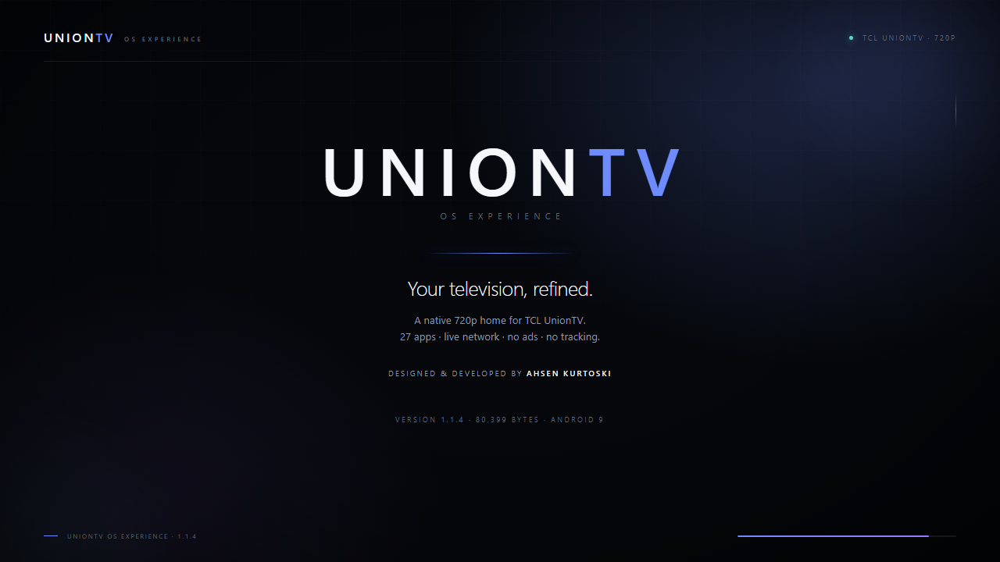

# UnionTV — 15-second launch film

[](uniontv-launch-15s.mp4)

**[Download the MP4](uniontv-launch-15s.mp4)** · 15.000 s · 1280×720 · 30 fps ·
H.264 / AAC stereo · 1,407,937 bytes

A short, quiet launch film for UnionTV OS Experience 1.1.4. It uses the real
1280×720 screenshots from the TCL UnionTV and an original ambient score. Network
names and local IP addresses are redacted in the published screenshots and film.
There is no stock footage, no licensed music and no voice-over.

**Release:** [UnionTV OS Experience 1.1.4](https://github.com/AhsenKurtoski/UnionTV-OS-Experience/releases/tag/v1.1.4) —
the signed APK and all launch assets are also available from the GitHub release.

## What is in this folder

| File | Purpose |
| --- | --- |
| `uniontv-launch-15s.mp4` | Final master, 15.000 s, H.264/AAC |
| `uniontv-launch-poster.png` | 1280×720 end-card poster used by the README |
| `contact-sheet.png` | Six-frame visual index of the film |
| `frames/` | Deterministic 1280×720 scene captures from the HTML stage |
| `uniontv-launch.html` | 1280×720 animated stage with the real screenshots |
| `make_score.py` | Original score generator; no dependencies or samples |
| `uniontv-launch-score.wav` | 15 s stereo score generated by the script |
| `render.sh` | Reproducible ffmpeg render from the checked-in frames and score |

## Timeline

| Start | Scene | Story |
| ---: | --- | --- |
| 0.00 | Intro | Wordmark, “Your television, refined.”, 1.1.4 credit |
| 2.05 | Home crossfade | A home that feels like yours; 27 apps, live Wi-Fi, Canali TV |
| 5.30 | Applications | Every app, one clean grid; real icons and sorting |
| 8.00 | Network | Live network, real control; SSID, IP and link facts |
| 10.30 | Settings | Made for the way you watch; accent, motion, clock, favourites |
| 12.10 | Final crossfade | UnionTV end card, developer credit and 1.1.4 facts |
| 15.00 | End | Fade to black |

Each scene has a slow zoom and the transitions are 0.45 s crossfades. The
progress line in the stage footer is a visual detail, not a live UI control.

## Design

- Deep navy-black base (`#05070b`) with restrained blue/periwinkle accents.
- Real TV captures shown inside a TV-like 16:9 panel, not redrawn mockups.
- Segoe UI / system sans typography, generous spacing and a single reading
  column.
- The end card repeats the brand, the developer credit, version 1.1.4 and the
  no-ads/no-tracking product facts.
- Resolution and safe margins are designed for 16:9; all content stays inside
  1280×720.

## How it was produced

1. The real 1.1.4 screenshots in `docs/audit/` were composed into
   `uniontv-launch.html`.
2. Edge in headless mode captured each deterministic scene at 1280×720 using
   the `?scene=` query (`intro`, `home`, `apps`, `network`, `settings`, `final`).
3. `make_score.py` generated the 15 s stereo WAV with only the Python standard
   library.
4. `render.sh` rendered six 30 fps clips, applied `zoompan` and `xfade`, mixed
   the score to AAC and wrote the MP4.

### Rebuild

```bash
python docs/launch/make_score.py
bash docs/launch/render.sh
```

`render.sh` requires `ffmpeg` on `PATH`. To re-capture the frames, serve the
project root and use Edge (or Chromium) headless:

```bash
python -m http.server 8765 --bind 127.0.0.1
EDGE="/c/Program Files (x86)/Microsoft/Edge/Application/msedge.exe"
for scene in intro home apps network settings final; do
  "$EDGE" --headless=new --disable-gpu --hide-scrollbars \
    --window-size=1280,720 --force-device-scale-factor=1 \
    --virtual-time-budget=2500 \
    --screenshot="docs/launch/frames/$scene.png" \
    "http://127.0.0.1:8765/docs/launch/uniontv-launch.html?scene=$scene"
done
```

The HTML stage remains interactive: open it without `?scene=`, call
`window.startLaunch()` from the console and it plays the 15 s sequence at 30
fps. The checked-in frames are used for the final MP4 so the master does not
depend on browser timing.

## Integrity

```text
SHA-256  MP4     6be9923b63d3e3474013024da9d451eda05804ddd15e568144a22d1d73b2e8d1
SHA-256  poster  d78a5729e9cf9ecd1f2f23061e4b011a633d96ba9ab390963cd154f2782868e3
Duration         15.000 s (video and audio)
Video            1280×720, 30 fps, H.264, yuv420p
Audio            AAC, 48 kHz, stereo
```

## Ownership and context

The film and score were authored for this independent project. Application
names, icons and TCL/Google marks belong to their respective owners; UnionTV is
not affiliated with, endorsed by or connected to TCL, Google or any application
vendor. The screenshots depict the real reference television. The film is a
promotional asset; runtime behaviour and test limits are documented in
[docs/QA.md](../QA.md).
